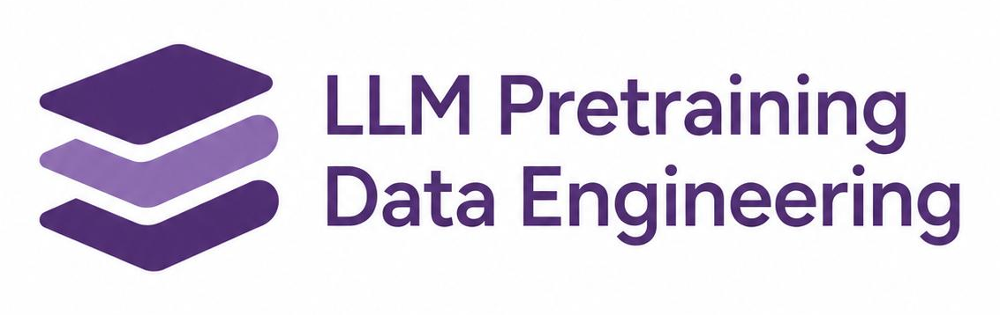

<h1 align="center">Awesome Pretraining Data Engineering</h1>

<b>English</b> · <a href="README_zh.md">简体中文</a>

<b>A curated reading list on the data that shapes language models.</b>

  
  

<a href="#reading-guide">Reading guide</a> · <a href="#technical-reports">Technical reports</a> · <a href="asset/LLM_Data_Survey_Revised.pdf">Our survey (PDF)</a>

**Scope:** text-based pretraining, including code and mathematical text. Document extraction is included when its output becomes text training data. Model architectures, instruction-tuning-only datasets, RLHF recipes, and multimodal alignment are outside the list's methodological scope.

> **How to read the tables.** Each literature table is sorted newest first, using first-submission dates within the same year. Years use the first submission date on the linked arXiv record, which can differ from the conference year or the digits in an arXiv identifier. Titles are taken from the current record. **Code** denotes a research implementation; **Code/data** includes accompanying data and **Dataset** points to a data release; **Model repo**, **Model collection**, **Pipeline**, **Eval/data**, and **Cookbook** describe other official resources. A repository link does not imply that a complete pretraining pipeline or training data is released. **—** means no official repository was verified in this curation pass, not that none exists.

## Contents

- [Reading guide & classification](#reading-guide)
- [1. Technical reports from major model developers](#technical-reports)
- [2. Corpus construction](#corpus-construction)
  - [2.1 Sources, acquisition & extraction](#corpora)
  - [2.2 Deduplication, filtering & document selection](#quality)
  - [2.3 Synthetic data & rewriting](#synthetic)
- [3. Data utilization](#data-utilization)
  - [3.1 Domain definitions, mixtures & budgets](#mixtures)
  - [3.2 Curricula, scheduling & repetition](#schedules)
  - [3.3 Context construction & training signals](#training-signals)
- [4. Pretraining evaluation](#evaluation)
  - [4.1 Benchmarks, protocols & recipe evaluation](#benchmarks)
  - [4.2 Data attribution, auditing & contamination](#auditing)
- [Acknowledgments](#acknowledgments)

## 🧭 Reading guide & classification

The three methodological groups follow **Sections III–V of our survey**. Deduplication and quality filtering share one table; long-context construction and training signals share another. Model-family reports stay together in a separate group.

| Group | Organizing question | What belongs here |
|:--|:--|:--|
| **[1. Technical reports](#technical-reports)** | What data recipe did a model developer use? | Integrated model-family reports, even when they cover several pipeline stages. |
| **[2. Corpus construction](#corpus-construction)** | What text is acquired, retained or created? | Corpus releases and extraction; offline deduplication/filtering/selection; synthesis and rewriting. |
| **[3. Data utilization](#data-utilization)** | How does the available corpus become training exposure and signals? | Domain mixtures and budgets; ordering, adaptive sampling and repetition; context assembly and token supervision. |
| **[4. Pretraining evaluation](#evaluation)** | How are data choices compared and their effects checked? | Benchmarks and controlled recipe comparisons; attribution, provenance, memorization and contamination audits. |

**Placement rule:** each paper has one primary entry, chosen by its main contribution. Cross-links connect related topics. Offline document filtering belongs in **2.2**; domain-level weights in **3.1**; training-time example selection and exposure schedules in **3.2**; sample/token loss weighting and target design in **3.3**. Auditing an existing corpus belongs in **4.2**. Broad surveys are listed below as orientation rather than mixed into method tables.

**Background surveys**

- **2026** · [**Data Mixing for Large Language Models Pretraining: A Survey and Outlook**](https://arxiv.org/abs/2604.16380) · —
- **2024** · [**A Survey on Data Selection for Language Models**](https://arxiv.org/abs/2402.16827) · [Reading list](https://github.com/alon-albalak/data-selection-survey)
- **2023** · [**Data Management For Training Large Language Models: A Survey**](https://arxiv.org/abs/2312.01700) · [Reading list](https://github.com/ZigeW/data_management_LLM)

| Your question | A useful starting point |
|:--|:--|
| How do I build a reproducible corpus? | [Sources & extraction](#corpora): Dolma → FineWeb → FineWeb2 |
| Which documents should I retain? | [Filtering & selection](#quality): Deduplicating Training Data → QuRating → BETR |
| How should I allocate tokens across sources? | [Mixtures & budgets](#mixtures): DoReMi → RegMix → scaling laws for mixtures |
| When should I use or repeat each source? | [Curricula & scheduling](#schedules): repeated-data scaling → RegMix-D → Replay on Demand |
| How should I arrange documents and supervise tokens? | [Context & signals](#training-signals): In-context Pretraining → Rho-1 → MeCo |
| How do I compare data recipes fairly? | [Benchmarks & protocols](#benchmarks): OLMES, DataComp-LM and DataDecide |
| How do I check provenance and contamination? | [Data auditing](#auditing): C4 audit, membership inference and contamination detection |

For industry practice, compare the data sections of **Llama 3**, **Qwen3**, **DeepSeek-V4 / V4.1-Flash**, **Kimi K2**, **GLM-5**, **Phi-4**, and **OLMo 3** below. These reports document recipes; they do not necessarily isolate the causal contribution of every data decision.

## 🏢 1. Technical reports from major model developers

Integrated accounts of corpus sources, filtering, synthesis, mixtures and training stages. Companies and major open-model research teams are grouped together here; architecture and post-training methods are outside this list’s methodological scope.

**50 papers**

| Year | Paper | Data-engineering focus | Code / official resource |
|:--:|:--|:--|:--|
| 2026 | [**DeepSeek-V4.1-Flash: Pushing the Limits of KV Cache Compression**](https://arxiv.org/abs/2609.19969) | **DeepSeek** · **V4.1-Flash** · updated text/code curation and training stages within a multimodal report | [Model repo](https://huggingface.co/deepseek-ai/DeepSeek-V4.1-Flash) · [Official PDF](https://huggingface.co/deepseek-ai/DeepSeek-V4.1-Flash/blob/main/DeepSeek_V41_Tech_Report.pdf) |
| 2026 | [**Solar Open 2 Technical Report**](https://arxiv.org/abs/2607.20062) | **Upstage** · Solar Open 2 · quality/rarity-aware curation and refinement of a 20T-token pool into a 10T mixture | — |
| 2026 | [**Nemotron 3 Ultra: Open, Efficient Mixture-of-Experts Hybrid Mamba-Transformer Model for Agentic Reasoning**](https://arxiv.org/abs/2606.15007) | **NVIDIA** · Nemotron 3 Ultra · 20T-token text pretraining, data recipe and context extension | [Model repo](https://github.com/NVIDIA-NeMo/Nemotron) |
| 2026 | [**DeepSeek-V4: Towards Highly Efficient Million-Token Context Intelligence**](https://arxiv.org/abs/2606.19348) | **DeepSeek** · **V4-Pro / V4-Flash** · shared report; 32T+ pretraining tokens, corpus curation and long-context training | [Model collection](https://huggingface.co/collections/deepseek-ai/deepseek-v4) · [Official PDF](https://huggingface.co/deepseek-ai/DeepSeek-V4-Pro/blob/main/DeepSeek_V4.pdf) |
| 2026 | [**Nemotron 3 Super: Open, Efficient Mixture-of-Experts Hybrid Mamba-Transformer Model for Agentic Reasoning**](https://arxiv.org/abs/2604.12374) | **NVIDIA** · Nemotron 3 Super · 25T-token pretraining, released datasets and training stages | [Model repo](https://github.com/NVIDIA-NeMo/Nemotron) |
| 2026 | [**GLM-5: from Vibe Coding to Agentic Engineering**](https://arxiv.org/abs/2602.15763) | **Z.ai / Tsinghua** · pretraining data and staged training disclosures | [Model repo](https://github.com/zai-org/GLM-5) |
| 2025 | [**Nemotron 3 Nano: Open, Efficient Mixture-of-Experts Hybrid Mamba-Transformer Model for Agentic Reasoning**](https://arxiv.org/abs/2512.20848) | **NVIDIA** · Nemotron 3 Nano · 25T-token text pretraining with expanded unique-token coverage | [Model repo](https://github.com/NVIDIA-NeMo/Nemotron) |
| 2025 | [**Olmo 3**](https://arxiv.org/abs/2512.13961) | **Ai2** · document extraction and mid-training data | [Training code](https://github.com/allenai/Olmo-core) |
| 2025 | [**GLM-4.5: Agentic, Reasoning, and Coding (ARC) Foundation Models**](https://arxiv.org/abs/2508.06471) | **Z.ai / Tsinghua** · staged pretraining and domain emphasis | [Model repo](https://github.com/zai-org/GLM-4.5) |
| 2025 | [**Kimi K2: Open Agentic Intelligence**](https://arxiv.org/abs/2507.20534) | **Moonshot AI** · document rewriting and data quality | [Model repo](https://github.com/MoonshotAI/Kimi-K2) |
| 2025 | [**Qwen3 Technical Report**](https://arxiv.org/abs/2505.09388) | **Alibaba** · Qwen3 · annotation and staged pretraining | [Model repo](https://github.com/QwenLM/Qwen3) |
| 2025 | [**Gemma 3 Technical Report**](https://arxiv.org/abs/2503.19786) | **Google DeepMind** · text-data disclosures within a multimodal report | [Model repo](https://github.com/google-deepmind/gemma) |
| 2025 | [**SmolLM2: When Smol Goes Big -- Data-Centric Training of a Small Language Model**](https://arxiv.org/abs/2502.02737) | **Hugging Face** · SmolLM2 · data-centric small-model training and open recipes | [Model repo](https://github.com/huggingface/smollm) |
| 2024 | [**2 OLMo 2 Furious**](https://arxiv.org/abs/2501.00656) | **Ai2** · staged training and data annealing | [Training code](https://github.com/allenai/Olmo-core) |
| 2024 | [**DeepSeek-V3 Technical Report**](https://arxiv.org/abs/2412.19437) | **DeepSeek** · corpus expansion and context extension | [Model repo](https://github.com/deepseek-ai/DeepSeek-V3) |
| 2024 | [**Qwen2.5 Technical Report**](https://arxiv.org/abs/2412.15115) | **Alibaba** · Qwen2.5 · synthetic and domain data | [Model repo](https://github.com/QwenLM/Qwen3) |
| 2024 | [**Phi-4 Technical Report**](https://arxiv.org/abs/2412.08905) | **Microsoft** · synthetic-data-intensive pretraining | [Cookbook](https://github.com/microsoft/PhiCookBook) |
| 2024 | [**Qwen2.5-Coder Technical Report**](https://arxiv.org/abs/2409.12186) | **Alibaba** · code corpus and synthetic data | [Model repo](https://github.com/QwenLM/Qwen3-Coder) |
| 2024 | [**Qwen2.5-Math Technical Report: Toward Mathematical Expert Model via Self-Improvement**](https://arxiv.org/abs/2409.12122) | **Alibaba** · mathematical data construction | [Model repo](https://github.com/QwenLM/Qwen2.5-Math) |
| 2024 | [**Gemma 2: Improving Open Language Models at a Practical Size**](https://arxiv.org/abs/2408.00118) | **Google DeepMind** · teacher-distribution pretraining targets | [Model repo](https://github.com/google-deepmind/gemma) |
| 2024 | [**The Llama 3 Herd of Models**](https://arxiv.org/abs/2407.21783) | **Meta** · Llama 3 · filtering, mixtures, annealing | [Model repo](https://github.com/meta-llama/llama3) |
| 2024 | [**Qwen2 Technical Report**](https://arxiv.org/abs/2407.10671) | **Alibaba** · Qwen2 · quality and domain coverage | [Model repo](https://github.com/QwenLM/Qwen3) |
| 2024 | [**ChatGLM: A Family of Large Language Models from GLM-130B to GLM-4 All Tools**](https://arxiv.org/abs/2406.12793) | **Z.ai / Tsinghua** · multilingual pretraining corpus | [Model repo](https://github.com/zai-org/GLM-4) |
| 2024 | [**DeepSeek-Coder-V2: Breaking the Barrier of Closed-Source Models in Code Intelligence**](https://arxiv.org/abs/2406.11931) | **DeepSeek** · continued code pretraining and infilling | [Model repo](https://github.com/deepseek-ai/DeepSeek-Coder-V2) |
| 2024 | [**Nemotron-4 340B Technical Report**](https://arxiv.org/abs/2406.11704) | **NVIDIA** · corpus mixture and staged training | — |
| 2024 | [**DeepSeek-V2: A Strong, Economical, and Efficient Mixture-of-Experts Language Model**](https://arxiv.org/abs/2405.04434) | **DeepSeek** · cross-snapshot deduplication and filtering | [Model repo](https://github.com/deepseek-ai/DeepSeek-V2) |
| 2024 | [**Phi-3 Technical Report: A Highly Capable Language Model Locally on Your Phone**](https://arxiv.org/abs/2404.14219) | **Microsoft** · data quality and synthetic text | [Cookbook](https://github.com/microsoft/PhiCookBook) |
| 2024 | [**MiniCPM: Unveiling the Potential of Small Language Models with Scalable Training Strategies**](https://arxiv.org/abs/2404.06395) | **OpenBMB** · data schedules and warmup-stable-decay | [Model repo](https://github.com/OpenBMB/MiniCPM) |
| 2024 | [**InternLM2 Technical Report**](https://arxiv.org/abs/2403.17297) | **Shanghai AI Lab** · deduplication and continued pretraining | [Model repo](https://github.com/InternLM/InternLM) |
| 2024 | [**Gemma: Open Models Based on Gemini Research and Technology**](https://arxiv.org/abs/2403.08295) | **Google DeepMind** · filtering and data governance | [Model repo](https://github.com/google-deepmind/gemma) |
| 2024 | [**Yi: Open Foundation Models by 01.AI**](https://arxiv.org/abs/2403.04652) | **01.AI** · quality filtering and data concentration | [Model repo](https://github.com/01-ai/Yi) |
| 2024 | [**StarCoder 2 and The Stack v2: The Next Generation**](https://arxiv.org/abs/2402.19173) | **BigCode** · The Stack v2 and code-data provenance | [Model repo](https://github.com/bigcode-project/starcoder2) |
| 2024 | [**OLMo: Accelerating the Science of Language Models**](https://arxiv.org/abs/2402.00838) | **Ai2** · fully open training and corpus provenance | [Training code](https://github.com/allenai/OLMo) |
| 2024 | [**DeepSeek LLM: Scaling Open-Source Language Models with Longtermism**](https://arxiv.org/abs/2401.02954) | **DeepSeek** · early corpus and scaling recipe | [Model repo](https://github.com/deepseek-ai/DeepSeek-LLM) |
| 2023 | [**The Falcon Series of Open Language Models**](https://arxiv.org/abs/2311.16867) | **TII** · web-centered training recipe | — |
| 2023 | [**Qwen Technical Report**](https://arxiv.org/abs/2309.16609) | **Alibaba** · Qwen · multilingual corpus construction | [Model repo](https://github.com/QwenLM/Qwen) |
| 2023 | [**Baichuan 2: Open Large-scale Language Models**](https://arxiv.org/abs/2309.10305) | **Baichuan** · multilingual corpus and data processing | [Model repo](https://github.com/baichuan-inc/Baichuan2) |
| 2023 | [**Textbooks Are All You Need II: phi-1.5 technical report**](https://arxiv.org/abs/2309.05463) | **Microsoft** · Phi-1.5 · synthetic and web-text mixture | — |
| 2023 | [**Code Llama: Open Foundation Models for Code**](https://arxiv.org/abs/2308.12950) | **Meta** · code specialization and infilling | [Model repo](https://github.com/meta-llama/codellama) |
| 2023 | [**Llama 2: Open Foundation and Fine-Tuned Chat Models**](https://arxiv.org/abs/2307.09288) | **Meta** · Llama 2 · expanded pretraining data | [Model repo](https://github.com/meta-llama/llama) |
| 2023 | [**Textbooks Are All You Need**](https://arxiv.org/abs/2306.11644) | **Microsoft** · Phi-1 · textbook-style synthetic pretraining | — |
| 2023 | [**PaLM 2 Technical Report**](https://arxiv.org/abs/2305.10403) | **Google DeepMind** · PaLM 2 · data balance and multilingual coverage | — |
| 2023 | [**StarCoder: may the source be with you!**](https://arxiv.org/abs/2305.06161) | **BigCode** · code curation and fill-in-the-middle | [Model repo](https://github.com/bigcode-project/starcoder) |
| 2023 | [**GPT-4 Technical Report**](https://arxiv.org/abs/2303.08774) | **OpenAI** · GPT-4 · limited pretraining disclosure | — |
| 2023 | [**LLaMA: Open and Efficient Foundation Language Models**](https://arxiv.org/abs/2302.13971) | **Meta** · LLaMA · public-source corpus construction | [Model repo](https://github.com/meta-llama/llama) |
| 2022 | [**BLOOM: A 176B-Parameter Open-Access Multilingual Language Model**](https://arxiv.org/abs/2211.05100) | **BigScience** · multilingual corpus governance and mixture | [Training code](https://github.com/bigscience-workshop/bigscience) |
| 2022 | [**GLM-130B: An Open Bilingual Pre-trained Model**](https://arxiv.org/abs/2210.02414) | **Z.ai / Tsinghua** · bilingual data | [Model repo](https://github.com/zai-org/GLM-130B) |
| 2022 | [**PaLM: Scaling Language Modeling with Pathways**](https://arxiv.org/abs/2204.02311) | **Google DeepMind** · PaLM · multilingual and code mixtures | — |
| 2021 | [**Scaling Language Models: Methods, Analysis & Insights from Training Gopher**](https://arxiv.org/abs/2112.11446) | **Google DeepMind** · Gopher · heuristic quality filtering | — |
| 2020 | [**Language Models are Few-Shot Learners**](https://arxiv.org/abs/2005.14165) | **OpenAI** · GPT-3 · corpus filtering and mixture design | [Eval/data](https://github.com/openai/gpt-3) |

[↑ Back to top](#top)

## 🧱 2. Corpus construction

Build the available corpus: acquire and extract text, decide which documents to keep, and create additional text. This group corresponds to **survey Section III**.

### 2.1 Sources, acquisition & extraction

Corpus releases, targeted web acquisition, processing pipelines and document-to-text extraction. A corpus paper stays here even when its pipeline also filters or rewrites text. FineWeb-Edu is covered by FineWeb; The Stack v2 is covered by StarCoder 2 in [technical reports](#technical-reports). DataComp-LM appears under [recipe evaluation](#benchmarks), reflecting its controlled benchmark contribution.

**24 papers**

| Year | Paper | Data-engineering focus | Code / official resource |
|:--:|:--|:--|:--|
| 2026 | [**Host-Aware Web Crawling for LLM Pretraining Data**](https://arxiv.org/abs/2610.13321) | Quality-aware allocation of crawl depth across web hosts | — |
| 2026 | [**ReScraper: Unified Scraping and Cleaning of Web Data for Effective LLM Pretraining**](https://arxiv.org/abs/2609.34287) | Unified learned extraction, cleaning and rewriting of web pages | [Code](https://github.com/cxcscmu/ReScraper) |
| 2026 | [**Data Scout: Targeted Web Crawling for Domain-Specific Pretraining Corpora**](https://arxiv.org/abs/2609.05766) | Targeted crawling for domain-specific pretraining corpora | [Code](https://github.com/IBM/data-scout) |
| 2026 | [**SPT: Skills as Pre-Training Data for Agentic Language Models**](https://arxiv.org/abs/2608.26563) | SkillCorpus / SPT: public skill packages as causal-LM mid-training data, with reference-aware file assembly | — |
| 2026 | [**GPT-NL Public Corpus: A Permissively Licensed, Dutch-First Dataset for LLM Pre-training**](https://arxiv.org/abs/2604.00920) | GPT-NL: permissively licensed Dutch-first collections with curated multilingual and code sources | [Pipeline](https://github.com/GPT-NL/data-curation-pipeline) |
| 2025 | [**Mangosteen: An Open Thai Corpus for Language Model Pretraining**](https://arxiv.org/abs/2507.14664) | Mangosteen: Thai-specific web filtering, non-web sources and a reproducible corpus pipeline | [Pipeline](https://github.com/vistec-AI/Mangosteen) |
| 2025 | [**FineWeb2: One Pipeline to Scale Them All -- Adapting Pre-Training Data Processing to Every Language**](https://arxiv.org/abs/2506.20920) | Multilingual corpus curation across more than 1,000 languages | [Pipeline](https://github.com/huggingface/datatrove) |
| 2025 | [**The Common Pile v0.1: An 8TB Dataset of Public Domain and Openly Licensed Text**](https://arxiv.org/abs/2506.05209) | Public-domain and openly licensed corpus with reproducible processing and training mixtures | [Pipeline](https://github.com/r-three/common-pile) |
| 2025 | [**Ultra-FineWeb: Efficient Data Filtering and Verification for High-Quality LLM Training Data**](https://arxiv.org/abs/2505.05427) | Ultra-FineWeb: English/Chinese web corpora with efficient seed selection, filtering and data verification | [Dataset](https://huggingface.co/datasets/openbmb/UltraFineWeb) |
| 2025 | [**olmOCR: Unlocking Trillions of Tokens in PDFs with Vision Language Models**](https://arxiv.org/abs/2502.18443) | PDF extraction for text pretraining | [Code](https://github.com/allenai/olmocr) |
| 2024 | [**Nemotron-CC: Transforming Common Crawl into a Refined Long-Horizon Pretraining Dataset**](https://arxiv.org/abs/2412.02595) | Classifier ensembles and synthetic rewriting | [Pipeline](https://github.com/NVIDIA-NeMo/Curator) |
| 2024 | [**RedPajama: an Open Dataset for Training Large Language Models**](https://arxiv.org/abs/2411.12372) | Web corpus with reusable quality annotations | [Pipeline](https://github.com/togethercomputer/RedPajama-Data) |
| 2024 | [**MinerU: An Open-Source Solution for Precise Document Content Extraction**](https://arxiv.org/abs/2409.18839) | Document extraction and reading-order recovery | [Code](https://github.com/opendatalab/MinerU) |
| 2024 | [**The FineWeb Datasets: Decanting the Web for the Finest Text Data at Scale**](https://arxiv.org/abs/2406.17557) | FineWeb / FineWeb-Edu · web-text processing and educational filtering | [Pipeline](https://github.com/huggingface/datatrove) |
| 2024 | [**Cleaner Pretraining Corpus Curation with Neural Web Scraping**](https://arxiv.org/abs/2402.14652) | NeuScraper: learned main-content extraction from webpages for cleaner pretraining text | [Code](https://github.com/OpenMatch/NeuScraper) |
| 2024 | [**Dolma: an Open Corpus of Three Trillion Tokens for Language Model Pretraining Research**](https://arxiv.org/abs/2402.00159) | Open three-trillion-token corpus and processing pipeline | [Pipeline](https://github.com/allenai/dolma) |
| 2023 | [**MathPile: A Billion-Token-Scale Pretraining Corpus for Math**](https://arxiv.org/abs/2312.17120) | MathPile: math-centric acquisition, cleaning, deduplication and benchmark decontamination | [Code/data](https://github.com/GAIR-NLP/MathPile) |
| 2023 | [**Data-Juicer: A One-Stop Data Processing System for Large Language Models**](https://arxiv.org/abs/2309.02033) | Composable data processing and recipe analysis | [Pipeline](https://github.com/datajuicer/data-juicer) |
| 2023 | [**Nougat: Neural Optical Understanding for Academic Documents**](https://arxiv.org/abs/2308.13418) | Academic PDF-to-text extraction | [Code](https://github.com/facebookresearch/nougat) |
| 2023 | [**The RefinedWeb Dataset for Falcon LLM: Outperforming Curated Corpora with Web Data, and Web Data Only**](https://arxiv.org/abs/2306.01116) | Web extraction, filtering and deduplication | — |
| 2022 | [**The Stack: 3 TB of permissively licensed source code**](https://arxiv.org/abs/2211.15533) | Permissively licensed source-code corpus | — |
| 2020 | [**The Pile: An 800GB Dataset of Diverse Text for Language Modeling**](https://arxiv.org/abs/2101.00027) | Diverse multi-source text corpus | [Pipeline](https://github.com/EleutherAI/the-pile) |
| 2020 | [**CLUECorpus2020: A Large-scale Chinese Corpus for Pre-training Language Model**](https://arxiv.org/abs/2003.01355) | Chinese pretraining corpus | [Eval/data](https://github.com/CLUEbenchmark/CLUECorpus2020) |
| 2019 | [**Exploring the Limits of Transfer Learning with a Unified Text-to-Text Transformer**](https://arxiv.org/abs/1910.10683) | C4 corpus construction; included for data, not architecture | [Code](https://github.com/google-research/text-to-text-transfer-transformer) |

[↑ Back to top](#top)

### 2.2 Deduplication, filtering & document selection

Methods that change which documents enter the corpus: duplicate removal, quality scoring, diversity-aware selection and target-distribution matching. Repeated training exposure belongs in [scheduling](#schedules); provenance and memorization studies belong in [auditing](#auditing).

**24 papers**

| Year | Paper | Data-engineering focus | Code / official resource |
|:--:|:--|:--|:--|
| 2026 | [**Adapting English Quality Classifiers for Multilingual LLM Pretraining Data Selection**](https://arxiv.org/abs/2610.11585) | Transferring English quality scores to multilingual corpus selection | — |
| 2026 | [**Fisher-Guided Submodular Data Selection for Continual Pre-Training of Large Language Models**](https://arxiv.org/abs/2610.02593) | Fisher-aware submodular selection of continued-pretraining documents to limit forgetting | — |
| 2026 | [**Towards Scalable Data Diversification for Language Model Pretraining via Leverage Score Sampling**](https://arxiv.org/abs/2609.32484) | Embedding-space diversification through leverage score sampling | [Code](https://github.com/mazailin/LevDataDiversity) |
| 2026 | [**AutoData: Agentic Search for Pre-training Data Selection**](https://arxiv.org/abs/2609.19754) | Agentic search over executable data-selection programs | [Code](https://github.com/WecoAI/AutoData) |
| 2026 | [**Edu-QuRating: Multi-Dimensional Educational Data Curation with Distilled Pairwise Judgements**](https://arxiv.org/abs/2609.09425) | Education-specific pairwise rubrics distilled into document-quality scorers | [Code](https://github.com/AI-for-Education/edu-qurating) |
| 2026 | [**Scalable Frequency- and Length-Aware Subdocument Deduplication for Large Language Model Pretraining**](https://arxiv.org/abs/2608.03089) | Global subdocument duplicate detection with frequency- and length-dependent copy-retention budgets | — |
| 2026 | [**PUFFER: Incremental Fuzzy Deduplication for Continuously Evolving Corpora**](https://arxiv.org/abs/2608.28622) | PUFFER: incremental MinHash-LSH deduplication with bounded memory and dataset withdrawal | [Code](https://github.com/Zyphra/puffer) |
| 2026 | [**DataOrchestra: Learning to Orchestrate Per-Example Curation of Pretraining Data**](https://arxiv.org/abs/2607.24717) | Per-example orchestration of retaining, cleaning and rewriting | [Code](https://github.com/GAIR-NLP/DataOrchestra) |
| 2026 | [**Spokes: Optimizing for Diverse Pretraining Data Selection**](https://arxiv.org/abs/2606.15216) | SPOKES: set-level diversity optimization, optionally combined with document-quality scores | — |
| 2026 | [**FOLD: Fuzzy Online Deduplication for Very Large Evolving Datasets via Approximate Nearest Neighbor Search**](https://arxiv.org/abs/2606.03001) | FOLD: online fuzzy deduplication with an incrementally updated approximate-neighbor index | — |
| 2026 | [**MIRA: Mid-training Rubric Anchoring for Source-Aware Data Selection**](https://arxiv.org/abs/2605.30288) | MIRA: source-specific rubric discovery and distilled scoring for code-oriented mid-training | — |
| 2026 | [**Toward Cross-Lingual Quality Classifiers for Multilingual Pretraining Data Selection**](https://arxiv.org/abs/2604.20549) | Multilingual pooling, cross-lingual quality classifiers and retention-rate calibration | — |
| 2026 | [**Target-Oriented Pretraining Data Selection via Neuron-Activated Graph**](https://arxiv.org/abs/2604.15706) | NAG: target-oriented document ranking using sparse neuron-activation graphs | [Code](https://github.com/asillycat/NAG) |
| 2026 | [**An Empirical Study on Influence-Based Pretraining Data Selection for Code Large Language Models**](https://arxiv.org/abs/2604.07769) | Influence-based code-data filtering with task-specific validation losses and stage-dependent utility | [Code](https://github.com/ZZR0/DIScore) |
| 2026 | [**Aligning the Query Space: Greedy Information Projection for Language Model Data Selection**](https://arxiv.org/abs/2603.13790) | GIP: query-aligned subset selection balancing quality and diversity; includes pretraining experiments | — |
| 2025 | [**BLISS: A Lightweight Bilevel Influence Scoring Method for Data Selection in Language Model Pretraining**](https://arxiv.org/abs/2510.06048) | BLISS: lightweight bilevel influence scoring with a from-scratch proxy model | [Code](https://github.com/MingruiLiu-ML-Lab/BLISS-Bilevel-Data-Selection) |
| 2025 | [**Removing Noise, not Finding Gold: Quality Filtering for Large-Scale Pretraining**](https://arxiv.org/abs/2510.00866) | Controlled analysis of classifier-based quality filtering and optimization-based data-quality estimates | — |
| 2025 | [**Language Models Improve When Pretraining Data Matches Target Tasks**](https://arxiv.org/abs/2507.12466) | Matching pretraining distributions to target tasks | — |
| 2025 | [**QuaDMix: Quality-Diversity Balanced Data Selection for Efficient LLM Pretraining**](https://arxiv.org/abs/2504.16511) | Joint quality filtering and domain-diversity balancing | — |
| 2025 | [**Meta-rater: A Multi-dimensional Data Selection Method for Pre-training Language Models**](https://arxiv.org/abs/2504.14194) | Multi-dimensional quality ratings for pretraining data selection | [Code](https://github.com/opendatalab/Meta-rater) |
| 2024 | [**QuRating: Selecting High-Quality Data for Training Language Models**](https://arxiv.org/abs/2402.09739) | Quality ratings for pretraining data selection | [Code](https://github.com/princeton-nlp/QuRating) |
| 2023 | [**SemDeDup: Data-efficient learning at web-scale through semantic deduplication**](https://arxiv.org/abs/2303.09540) | Semantic deduplication beyond lexical overlap | [Code](https://github.com/facebookresearch/SemDeDup) |
| 2023 | [**Data Selection for Language Models via Importance Resampling**](https://arxiv.org/abs/2302.03169) | Importance-resampling-based data selection | [Code](https://github.com/p-lambda/dsir) |
| 2021 | [**Deduplicating Training Data Makes Language Models Better**](https://arxiv.org/abs/2107.06499) | Exact and near-duplicate removal | [Code](https://github.com/google-research/deduplicate-text-datasets) |

[↑ Back to top](#top)

### 2.3 Synthetic data & rewriting

Methods that generate or transform training text, including source-conditioned rewriting and synthetic long documents, plus studies of synthetic-data scaling and model collapse. Arranging existing documents into sequences belongs in [context construction](#training-signals). Model-specific recipes remain in [technical reports](#technical-reports).

**17 papers**

| Year | Paper | Data-engineering focus | Code / official resource |
|:--:|:--|:--|:--|
| 2026 | [**How Much Is an AI Token Worth? Scaling Laws for Wild AI-Generated Web Text**](https://arxiv.org/abs/2609.40295) | WildAI: scaling effects of naturally occurring AI-generated web text under controlled mixtures | [Code/data](https://github.com/pangramlabs/WildAI) |
| 2026 | [**Synthetic Pre-pretraining Survives Scale, but Not as a Grammatical Prior**](https://arxiv.org/abs/2609.39827) | Synthetic pre-pretraining across 500M–7B models; tests retrieval versus grammatical transfer | [Code](https://github.com/gucci-j/verify-ppt-at-scale) |
| 2026 | [**It's All Training: A Fully Synthetic Single-Stage Recipe for LLMs**](https://arxiv.org/abs/2609.37891) | SYNTH: grounded synthetic amplification of Wikipedia seeds for single-stage language-model training | [Dataset](https://huggingface.co/datasets/PleIAs/SYNTH) |
| 2026 | [**Self-Play Pretraining with Zero Data**](https://arxiv.org/abs/2609.30063) | Proof of concept: self-play generates executable programs and byte sequences for pretraining from scratch | — |
| 2026 | [**REER-PT: Reverse-Engineered Reasoning for Perplexity-Guided Pre-training Data Augmentation**](https://arxiv.org/abs/2608.30627) | REER-PT: sparse reasoning annotations inserted into raw text using perplexity and leakage controls | — |
| 2026 | [**Unfolding Scientific Papers into Multi-Turn Generation Trajectories for Continued Pre-Training**](https://arxiv.org/abs/2608.25826) | Teacher-reconstructed writing plans and deliberation augment intact scientific papers for continued pretraining | — |
| 2026 | [**UltraX: Refining Pre-Training Data at Scale with Adaptive Programmatic Editing**](https://arxiv.org/abs/2607.08646) | UltraX: scalable text refinement through validated insertion, deletion and modification programs | [Code](https://github.com/OpenBMB/UltraX) |
| 2026 | [**Data-efficient pre-training by scaling synthetic megadocs**](https://arxiv.org/abs/2603.18534) | Long synthetic sequences built from rephrases and inserted rationales | [Code](https://github.com/marin-community/marin) |
| 2026 | [**FineInstructions: Scaling Synthetic Instructions to Pre-Training Scale**](https://arxiv.org/abs/2601.22146) | Document-grounded synthetic instructions for from-scratch pretraining | — |
| 2025 | [**Demystifying Synthetic Data in LLM Pre-training: A Systematic Study of Scaling Laws, Benefits, and Pitfalls**](https://arxiv.org/abs/2510.01631) | Controlled study of synthetic types, mixtures and scaling | — |
| 2025 | [**BeyondWeb: Lessons from Scaling Synthetic Data for Trillion-scale Pretraining**](https://arxiv.org/abs/2508.10975) | Source selection, rewriting style and generator choices at pretraining scale | — |
| 2025 | [**Rewriting Pre-Training Data Boosts LLM Performance in Math and Code**](https://arxiv.org/abs/2505.02881) | SwallowCode / SwallowMath: domain-specific rewriting for continued pretraining | [Code](https://github.com/rioyokotalab/swallow-code-math) |
| 2024 | [**Is Model Collapse Inevitable? Breaking the Curse of Recursion by Accumulating Real and Synthetic Data**](https://arxiv.org/abs/2404.01413) | Synthetic data accumulation and model collapse | — |
| 2024 | [**A Tale of Tails: Model Collapse as a Change of Scaling Laws**](https://arxiv.org/abs/2402.07043) | Scaling-law perspective on model collapse | — |
| 2024 | [**Rephrasing the Web: A Recipe for Compute and Data-Efficient Language Modeling**](https://arxiv.org/abs/2401.16380) | Source-conditioned rewriting for pretraining | — |
| 2023 | [**The Curse of Recursion: Training on Generated Data Makes Models Forget**](https://arxiv.org/abs/2305.17493) | Recursive synthetic training and model collapse | — |
| 2023 | [**TinyStories: How Small Can Language Models Be and Still Speak Coherent English?**](https://arxiv.org/abs/2305.07759) | Controlled synthetic stories for small-model pretraining | — |

[↑ Back to top](#top)

## ⚙️ 3. Data utilization

Turn the available corpus into training exposure and prediction targets. This group corresponds to **survey Section IV**.

### 3.1 Domain definitions, mixtures & budgets

Define source/topic domains, choose their sampling weights, and allocate token or compute budgets. Tokenizer-training mixtures are included when they determine multilingual data representation and compression. Includes static and adaptive domain reweighting (e.g., DoReMi, PiKE and ToReMi). Methods centered on the order or trajectory of exposure appear in [scheduling](#schedules); studies testing whether small experiments transfer appear in [recipe evaluation](#benchmarks).

**23 papers**

| Year | Paper | Data-engineering focus | Code / official resource |
|:--:|:--|:--|:--|
| 2026 | [**Hubs or Fringes: Pretraining Data Selection via Web Graph Centrality**](https://arxiv.org/abs/2606.11499) | WebGraphMix: mix central and peripheral web hosts using graph structure and quality scores | [Code](https://github.com/princeton-pli/WebGraphMix) |
| 2026 | [**Explaining Data Mixing Scaling Laws**](https://arxiv.org/abs/2606.08167) | Theory and empirical prediction of data-mixture effects | [Code](https://github.com/meiqwq/Explaining-Data-Mixing-Scaling-Laws) |
| 2026 | [**TANDEM: Bi-Level Data Mixture Optimization with Twin Networks**](https://arxiv.org/abs/2606.04401) | Bi-level mixture optimization with twin networks | — |
| 2026 | [**Always Learning, Always Mixing: Efficient and Simple Data Mixing All The Time**](https://arxiv.org/abs/2605.15220) | OP-Mix: on-policy mixture search through low-rank adapter interpolation on the current model | — |
| 2026 | [**Capacity-Aware Mixture Law Enables Efficient LLM Data Optimization**](https://arxiv.org/abs/2603.08022) | CAMEL: capacity-aware mixture laws and loss-to-benchmark prediction for cross-scale data optimization | — |
| 2026 | [**Decouple Searching from Training: Scaling Data Mixing via Model Merging for Large Language Model Pre-training**](https://arxiv.org/abs/2602.00747) | DeMix: model-merging proxies for mixture search, with a released 22T-token corpus | [Code/data](https://github.com/Lucius-lsr/DeMix) |
| 2026 | [**MergeMix: Optimizing Mid-Training Data Mixtures via Learnable Model Merging**](https://arxiv.org/abs/2601.17858) | MergeMix: learnable merging weights as proxies for mid-training data ratios | — |
| 2026 | [**TREX: Tokenizer Regression for Optimal Data Mixture**](https://arxiv.org/abs/2601.13588) | TREX: proxy-tokenizer regression optimizes multilingual tokenizer-training mixtures | [Code](https://github.com/HanGyeol-Yoo/TReX) |
| 2025 | [**Scaling Laws for Optimal Data Mixtures**](https://arxiv.org/abs/2507.09404) | Scaling laws for predicting optimal data mixtures | — |
| 2025 | [**Nemotron-CLIMB: CLustering-based Iterative Data Mixture Bootstrapping for Language Model Pre-training**](https://arxiv.org/abs/2504.13161) | Semantic clustering and iterative proxy-based mixture optimization | — |
| 2025 | [**ToReMi: Topic-Aware Data Reweighting for Dynamic Pre-Training Data Selection**](https://arxiv.org/abs/2504.00695) | Topic-aware reweighting using observed learning dynamics | [Code](https://github.com/zxx000728/ToReMi) |
| 2025 | [**MixMin: Finding Data Mixtures via Convex Minimization**](https://arxiv.org/abs/2502.10510) | Convex optimization of data-mixture objectives | — |
| 2025 | [**Organize the Web: Constructing Domains Enhances Pre-Training Data Curation**](https://arxiv.org/abs/2502.10341) | WebOrganizer: topic and format annotations for domain-aware curation | [Code](https://github.com/CodeCreator/WebOrganizer) |
| 2025 | [**PiKE: Adaptive Data Mixing for Large-Scale Multi-Task Learning Under Low Gradient Conflicts**](https://arxiv.org/abs/2502.06244) | Online mixture adaptation using gradient statistics | — |
| 2025 | [**Optimizing Pretraining Data Mixtures with LLM-Estimated Utility**](https://arxiv.org/abs/2501.11747) | LLM-estimated utility for mixture design | — |
| 2024 | [**AutoScale: Scale-Aware Data Mixing for Pre-Training LLMs**](https://arxiv.org/abs/2407.20177) | Scale-dependent mixture selection | [Code](https://github.com/feiyang-k/AutoScale) |
| 2024 | [**RegMix: Data Mixture as Regression for Language Model Pre-training**](https://arxiv.org/abs/2407.01492) | Proxy regression for mixture optimization | [Code](https://github.com/sail-sg/regmix) |
| 2024 | [**BiMix: A Bivariate Data Mixing Law for Language Model Pretraining**](https://arxiv.org/abs/2405.14908) | Joint scaling of mixture and training volume | — |
| 2024 | [**Data Mixing Laws: Optimizing Data Mixtures by Predicting Language Modeling Performance**](https://arxiv.org/abs/2403.16952) | Predicting performance across domain mixtures | [Code](https://github.com/yegcjs/mixinglaws) |
| 2023 | [**Beyond Chinchilla-Optimal: Accounting for Inference in Language Model Scaling Laws**](https://arxiv.org/abs/2401.00448) | Training-inference trade-offs in data budgets | — |
| 2023 | [**DoReMi: Optimizing Data Mixtures Speeds Up Language Model Pretraining**](https://arxiv.org/abs/2305.10429) | Distributionally robust domain reweighting | [Code](https://github.com/sangmichaelxie/doremi) |
| 2022 | [**Training Compute-Optimal Large Language Models**](https://arxiv.org/abs/2203.15556) | Chinchilla · token and compute budgeting | — |
| 2020 | [**Scaling Laws for Neural Language Models**](https://arxiv.org/abs/2001.08361) | Model, data and compute allocation | — |

[↑ Back to top](#top)

### 3.2 Curricula, scheduling & repetition

Choose when and how often data is consumed: stage transitions, dynamic mixture trajectories, online per-example selection, replay and repeated epochs. RegMix-D belongs here because it optimizes training trajectories; RegMix belongs in [mixtures](#mixtures) because it predicts mixture quality.

**16 papers**

| Year | Paper | Data-engineering focus | Code / official resource |
|:--:|:--|:--|:--|
| 2026 | [**Specialists Learn Faster: Knowledge Organization in Pre-training Shapes Knowledge Update Efficiency**](https://arxiv.org/abs/2610.13835) | Temporal organization of pretraining knowledge and the cost of subsequent knowledge updates | — |
| 2026 | [**What Is a Repeated Token Worth? The Scaling Geometry of Multi-Epoch Pretraining**](https://arxiv.org/abs/2610.05591) | Multi-epoch scaling laws separate the value of repeated tokens from fresh-data opportunity cost | — |
| 2026 | [**Selecting Repetition Counts Across Model Scales in Data-Constrained Pretraining**](https://arxiv.org/abs/2610.05126) | Small-model loss curves shortlist repetition counts for larger data-constrained runs | — |
| 2026 | [**OptiSelect: How does the Optimizer Shape Data Curriculum?**](https://arxiv.org/abs/2610.03432) | Optimizer-dependent geometry for online example selection | — |
| 2026 | [**Replay on Demand: An Emergent Curriculum for Balancing Adaptation and Forgetting in Continued Pretraining**](https://arxiv.org/abs/2609.40089) | Adaptive replay to balance learning and forgetting during continued pretraining | [Code](https://github.com/bethgelab/replay-on-demand) |
| 2026 | [**Scaling Domain Data Repetition in LLM Pretraining**](https://arxiv.org/abs/2608.14071) | Scaling effects of repeated exposure to domain data | — |
| 2026 | [**Internal Data Repetition Destroys Language Models**](https://arxiv.org/abs/2606.24998) | Controlled duplicate exposure quantifies how repeat structure wastes pretraining compute | — |
| 2026 | [**Holistic Data Scheduler for LLM Pre-training via Multi-Objective Reinforcement Learning**](https://arxiv.org/abs/2606.24133) | Multi-objective reinforcement learning for pretraining data scheduling | [Code](https://github.com/DANG-ai/LLM-Training-Holistic-Data-Schedule) |
| 2026 | [**RegMix-D: Dynamic Data Mixing via Proxy Training Trajectories**](https://arxiv.org/abs/2606.18663) | Dynamic mixture schedules from proxy training trajectories | — |
| 2026 | [**Demystifying Data Organization for Enhanced LLM Training**](https://arxiv.org/abs/2605.30334) | STR / SAW: sample-score-based data ordering, cyclic schedules and local diversity | [Code](https://github.com/microsoft/data-efficacy) |
| 2026 | [**How Should LLMs Consume High-Quality Data? Optimal Data Scheduling via Quality-Aware Functional Scaling Laws**](https://arxiv.org/abs/2605.25698) | Quality-aware functional scaling laws for training-data schedules | — |
| 2026 | [**Cram Less to Fit More: Training Data Pruning Improves Memorization of Facts**](https://arxiv.org/abs/2604.08519) | Loss-based selective training balances fact coverage and repetition against model memory capacity | — |
| 2026 | [**DataFlex: A Unified Framework for Data-Centric Dynamic Training of Large Language Models**](https://arxiv.org/abs/2603.26164) | DataFlex: unified infrastructure for dynamic sample selection, domain mixing and sample reweighting | — |
| 2025 | [**How Learning Rate Decay Wastes Your Best Data in Curriculum-Based LLM Pretraining**](https://arxiv.org/abs/2511.18903) | Interaction of data quality and learning-rate schedules | — |
| 2023 | [**Scaling Data-Constrained Language Models**](https://arxiv.org/abs/2305.16264) | Repeated epochs under limited fresh data | [Code](https://github.com/huggingface/datablations) |
| 2022 | [**Scaling Laws and Interpretability of Learning from Repeated Data**](https://arxiv.org/abs/2205.10487) | Effects of repeated training data | — |

[↑ Back to top](#top)

### 3.3 Context construction & training signals

Choose what the model sees together and which tokens supply supervision: long-context dependency selection, document packing, truncation, infilling, metadata conditioning, adaptive prediction targets and sample/token loss weighting. This combines **survey Sections IV-C and IV-D** without adding separate architecture topics.

**11 papers**

| Year | Paper | Data-engineering focus | Code / official resource |
|:--:|:--|:--|:--|
| 2026 | [**Rethinking Data Curation in LLM Training: Online Reweighting Offers Better Generalization than Offline Methods**](https://arxiv.org/abs/2605.05227) | ADAPT: adaptive per-example loss weighting during pretraining without removing samples | [Code](https://github.com/Ryan0v0/ADAPT) |
| 2026 | [**KoCo: Conditioning Language Model Pre-training on Knowledge Coordinates**](https://arxiv.org/abs/2604.12397) | Knowledge-coordinate metadata conditioning | — |
| 2026 | [**Learning What to Predict: Downstream-Guided Task Design for Continued Pretraining**](https://arxiv.org/abs/2601.22108) | V-pretraining: downstream feedback guides self-supervised prediction targets during continued pretraining | — |
| 2025 | [**Beyond URLs: Metadata Diversity and Position for Efficient LLM Pretraining**](https://arxiv.org/abs/2511.21613) | Metadata diversity and placement | — |
| 2025 | [**Beyond Length: Quantifying Long-Range Information for Long-Context LLM Pretraining Data**](https://arxiv.org/abs/2510.25804) | LongFilter: long-versus-short-context information gain selects dependency-rich training sequences | [Code](https://github.com/HaoranDeng/LongFilter) |
| 2025 | [**LADM: Long-context Training Data Selection with Attention-based Dependency Measurement for LLMs**](https://arxiv.org/abs/2503.02502) | Attention-based dependency measures for long-context data selection | [Code](https://github.com/ZNLP/LADM) |
| 2025 | [**Metadata Conditioning Accelerates Language Model Pre-training**](https://arxiv.org/abs/2501.01956) | Metadata prefixes for more efficient pretraining | [Code](https://github.com/princeton-pli/MeCo) |
| 2024 | [**Fewer Truncations Improve Language Modeling**](https://arxiv.org/abs/2404.10830) | Best-fit packing and reduced truncation | — |
| 2024 | [**Rho-1: Not All Tokens Are What You Need**](https://arxiv.org/abs/2404.07965) | Selective token supervision | [Code](https://github.com/microsoft/rho) |
| 2023 | [**In-context Pretraining: Language Modeling Beyond Document Boundaries**](https://arxiv.org/abs/2310.10638) | Retrieval-based document packing | [Code](https://github.com/swj0419/in-context-pretraining) |
| 2022 | [**Efficient Training of Language Models to Fill in the Middle**](https://arxiv.org/abs/2207.14255) | Fill-in-the-middle sequence transformations | — |

[↑ Back to top](#top)

## 📏 4. Pretraining evaluation

Measure the effects of data decisions and check the validity of those measurements. This group corresponds to **survey Section V**.

### 4.1 Benchmarks, protocols & recipe evaluation

Downstream capability benchmarks, standardized scoring protocols, controlled data-recipe comparisons and proxy-to-target transfer studies. DataComp-LM and DataDecide provide experimental frameworks for comparing recipes. Compare interventions at matched budgets with fixed prompting and scoring.

**18 papers**

| Year | Paper | Data-engineering focus | Code / official resource |
|:--:|:--|:--|:--|
| 2026 | [**Conditional Transfer from Controlled Pretraining Mixtures to Code**](https://arxiv.org/abs/2610.11548) | Controlled code mixtures distinguish task-loss reduction from downstream transfer | — |
| 2026 | [**Forecasting Downstream Performance of LLMs With Proxy Metrics**](https://arxiv.org/abs/2605.18607) | Token-distribution proxy metrics rank candidate corpora and forecast downstream performance | [Code](https://github.com/McGill-NLP/proxy-metrics) |
| 2026 | [**What do Language Models Learn and When? The Implicit Curriculum Hypothesis**](https://arxiv.org/abs/2604.08510) | Elemental tasks measure skill-acquisition order across pretraining checkpoints and mixtures | [Eval/data](https://github.com/KaiserWhoLearns/ElementalTask) |
| 2025 | [**Can Small Training Runs Reliably Guide Data Curation? Rethinking Proxy-Model Practice**](https://arxiv.org/abs/2512.24503) | Reliability and transfer limits of small-run data-curation decisions | — |
| 2025 | [**DataDecide: How to Predict Best Pretraining Data with Small Experiments**](https://arxiv.org/abs/2504.11393) | Small-scale experiments for selecting pretraining data | [Code](https://github.com/allenai/DataDecide) |
| 2024 | [**DataComp-LM: In search of the next generation of training sets for language models**](https://arxiv.org/abs/2406.11794) | Controlled data-selection benchmark and open corpus | [Code](https://github.com/mlfoundations/dclm) |
| 2024 | [**OLMES: A Standard for Language Model Evaluations**](https://arxiv.org/abs/2406.08446) | Standardized base-model evaluation | [Eval/data](https://github.com/allenai/olmes) |
| 2024 | [**MMLU-Pro: A More Robust and Challenging Multi-Task Language Understanding Benchmark**](https://arxiv.org/abs/2406.01574) | More robust multitask evaluation | [Eval/data](https://github.com/TIGER-AI-Lab/MMLU-Pro) |
| 2024 | [**Language models scale reliably with over-training and on downstream tasks**](https://arxiv.org/abs/2403.08540) | Continuous losses and downstream scaling predictions | [Eval/data](https://github.com/mlfoundations/scaling) |
| 2023 | [**GPQA: A Graduate-Level Google-Proof Q&A Benchmark**](https://arxiv.org/abs/2311.12022) | Graduate-level question answering | [Eval/data](https://github.com/idavidrein/gpqa) |
| 2023 | [**C-Eval: A Multi-Level Multi-Discipline Chinese Evaluation Suite for Foundation Models**](https://arxiv.org/abs/2305.08322) | Chinese multitask evaluation | [Eval/data](https://github.com/hkust-nlp/ceval) |
| 2023 | [**Is Your Code Generated by ChatGPT Really Correct? Rigorous Evaluation of Large Language Models for Code Generation**](https://arxiv.org/abs/2305.01210) | EvalPlus · stronger code correctness tests | [Eval/data](https://github.com/evalplus/evalplus) |
| 2023 | [**Are Emergent Abilities of Large Language Models a Mirage?**](https://arxiv.org/abs/2304.15004) | Metric sensitivity and apparent capability transitions | — |
| 2023 | [**Pythia: A Suite for Analyzing Large Language Models Across Training and Scaling**](https://arxiv.org/abs/2304.01373) | Controlled checkpoints for studying training-data effects | [Eval/data](https://github.com/EleutherAI/pythia) |
| 2021 | [**Training Verifiers to Solve Math Word Problems**](https://arxiv.org/abs/2110.14168) | GSM8K · mathematical reasoning evaluation | [Eval/data](https://github.com/openai/grade-school-math) |
| 2021 | [**Evaluating Large Language Models Trained on Code**](https://arxiv.org/abs/2107.03374) | HumanEval · functional correctness of code | [Eval/data](https://github.com/openai/human-eval) |
| 2021 | [**Measuring Mathematical Problem Solving With the MATH Dataset**](https://arxiv.org/abs/2103.03874) | MATH · mathematical problem solving | [Eval/data](https://github.com/hendrycks/math) |
| 2020 | [**Measuring Massive Multitask Language Understanding**](https://arxiv.org/abs/2009.03300) | MMLU · knowledge and reasoning evaluation | [Eval/data](https://github.com/hendrycks/test) |

[↑ Back to top](#top)

### 4.2 Data attribution, auditing & contamination

Measure which data influences a model, inspect source coverage and access conditions, and detect memorization or benchmark/synthetic contamination. These studies assess data and evaluation validity; methods for constructing a cleaner corpus appear in [filtering & selection](#quality).

**14 papers**

| Year | Paper | Data-engineering focus | Code / official resource |
|:--:|:--|:--|:--|
| 2026 | [**OLMo-Detect: A Multi-Stage, Confounder-Controlled Benchmark for Membership Inference on Large Language Models**](https://arxiv.org/abs/2610.02986) | OLMo-Detect: membership inference with controls for distribution shifts and training stage | [Eval/data](https://github.com/LuckyDaydreamer/OLMo-Detect) |
| 2026 | [**FineWeb-CLaR: Culture, Language, and Region Annotations for Benchmark-Aligned Corpus Auditing**](https://arxiv.org/abs/2609.25298) | Culture, language and regional annotations for corpus auditing | [Eval/data](https://github.com/Yusser96/FineWeb-CLaR) |
| 2026 | [**SynthSentry: Detecting Synthetic Data Contamination in Language Model Training Data**](https://arxiv.org/abs/2609.12353) | Corpus-level screening for synthetic-origin signals | — |
| 2026 | [**Measuring Task-Agnostic Training Data Influence Across Language Model Pretraining**](https://arxiv.org/abs/2608.13515) | Task-agnostic data influence measured across training trajectories | — |
| 2026 | [**GRASP: Geometry-aware Residual Alignment for Scalable Pretraining Data Attribution**](https://arxiv.org/abs/2606.06892) | Residual alignment and geometry for pretraining data attribution | [Code](https://github.com/MoonLight-Sherry/GRASP) |
| 2026 | [**LLMSurgeon: Diagnosing Data Mixture of Large Language Models**](https://arxiv.org/abs/2605.30348) | LLMSurgeon / LLMScan: infer domain-level pretraining mixtures from generated text | [Code](https://github.com/Yaxin9Luo/LLMSurgeon) |
| 2026 | [**Sketching the Readout of Large Language Models for Scalable Data Attribution and Valuation**](https://arxiv.org/abs/2604.16197) | RISE: compressed output-layer influence representations for attribution and candidate-data valuation | — |
| 2025 | [**DyePack: Provably Flagging Test Set Contamination in LLMs Using Backdoors**](https://arxiv.org/abs/2505.23001) | Backdoor-based tests for detecting benchmark contamination | [Code](https://github.com/chengez/DyePack) |
| 2025 | [**The Emperor's New Clothes in Benchmarking? A Rigorous Examination of Mitigation Strategies for LLM Benchmark Data Contamination**](https://arxiv.org/abs/2503.16402) | Controlled assessment of benchmark contamination mitigation strategies | [Code](https://github.com/ASTRAL-Group/BDC-mitigation-assessment) |
| 2024 | [**Consent in Crisis: The Rapid Decline of the AI Data Commons**](https://arxiv.org/abs/2407.14933) | Web-data access and provenance | — |
| 2023 | [**Rethinking Benchmark and Contamination for Language Models with Rephrased Samples**](https://arxiv.org/abs/2311.04850) | Benchmark decontamination beyond exact matching | [Eval/data](https://github.com/lm-sys/llm-decontaminator) |
| 2023 | [**Detecting Pretraining Data from Large Language Models**](https://arxiv.org/abs/2310.16789) | Membership inference for detecting pretraining data | [Eval/data](https://github.com/swj0419/detect-pretrain-code) |
| 2022 | [**Quantifying Memorization Across Neural Language Models**](https://arxiv.org/abs/2202.07646) | Memorization and repeated sequences | — |
| 2021 | [**Documenting Large Webtext Corpora: A Case Study on the Colossal Clean Crawled Corpus**](https://arxiv.org/abs/2104.08758) | C4 audit: content, bias and filtering effects | — |

[↑ Back to top](#top)

## Acknowledgments

This collection is organized around [*Data Engineering in Large Language Model Pretraining: A Survey*](asset/LLM_Data_Survey_Revised.pdf) by Yudong Li, Ruiqi Zhou, Peiru Yang, Shiyi Zheng, Linlin Shen, Xintian Li, and Yongfeng Huang.

The presentation is inspired by [Awesome Multimodal Large Language Models](https://github.com/BradyFU/Awesome-Multimodal-Large-Language-Models). Suggestions for relevant papers and corrections are welcome through issues or pull requests.

[↑ Back to top](#top)
